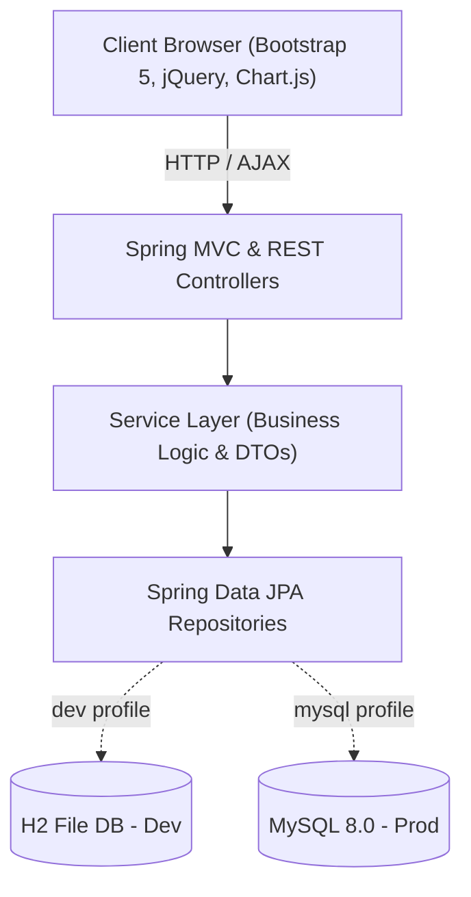

# 💳 SpendWise — Enterprise Expense Tracker System

<div align="center">

[](https://expense-tracker-system-yoxp.onrender.com/)
[](https://openjdk.org/)
[](https://spring.io/projects/spring-boot)
[](https://www.docker.com/)
[](LICENSE)

**A modern, full-stack, enterprise-grade financial management and expense tracking platform built with Spring Boot 3, Hibernate/JPA, Thymeleaf, MySQL, Bootstrap 5, jQuery AJAX, and Chart.js.**

[Explore Live Demo](https://expense-tracker-system-yoxp.onrender.com/) • [Key Features](#-key-features) • [Tech Stack](#-technology-stack) • [Quick Start](#-quick-start) • [API Documentation](#-rest-api-documentation) • [Docker & Deployment](#-docker--render-cloud-deployment)

</div>

---

## 🌐 Live Application

The application is deployed live in production on Render using Docker:

| 🔗 Resource | 📌 Access Details |
|---|---|
| **Live Web App** | **[https://expense-tracker-system-yoxp.onrender.com/](https://expense-tracker-system-yoxp.onrender.com/)** |
| **Demo Username** | `demo` |
| **Demo Password** | `password123` |
| **GitHub Repository** | [chandana-builds/Expense-Tracker-System](https://github.com/chandana-builds/Expense-Tracker-System) |

> 💡 *Note: The live demo is pre-seeded with sample income, expenses, budgets, and category breakdowns so you can immediately test interactive charts and filters.*

---

## 🌟 Key Features

### 📊 Executive Financial Dashboard
- **Real-Time Financial KPIs**: Total Balance, Monthly Inflow, Monthly Outflow, Net Savings, and Savings Rate percentage with month-over-month indicators.
- **Interactive Visualizations (Chart.js)**:
  - 6-month historical cash flow trends (Income vs. Expense vs. Net Savings).
  - Current-month expense breakdown doughnut chart with interactive category percentages.
- **Recent Activity Feed**: Quick-view list of recent transactions with category badges and payment methods.

### 💸 Transaction Management
- **Full CRUD Support**: Create, edit, inspect, and delete income and expense records.
- **Asynchronous jQuery AJAX Filtering**: Dynamic live search by title/notes, transaction type, category, and date range without full page reloads.
- **Multiple Payment Types**: Support for Cash, UPI, Credit Card, Debit Card, and Net Banking.
- **CSV Data Export**: Single-click export of filtered transaction histories directly into CSV format.

### 🎯 Smart Budget Tracking & Alerts
- **Category-Level Limits**: Set and manage custom monthly spending limits for any category.
- **Visual Threshold Indicators**: Dynamic progress bars that adjust color based on consumption:
  - 🟢 **Safe**: < 75% limit used
  - 🟡 **Caution**: 75% – 99% limit used
  - 🔴 **Over Budget**: 100%+ limit exceeded with danger banner alert

### 🏷️ Category Management
- **Preloaded System Categories**: Pre-seeded with essentials (*Food & Dining, Rent & Housing, Transportation, Utilities, Salary, Freelance, etc.*).
- **Custom User Categories**: Create personalized categories with a built-in color picker and Bootstrap Icons selector.

### 🌓 User Experience & Security
- **Modern Glassmorphic UI**: Custom CSS design tokens, smooth animations, responsive Bootstrap 5 layout for mobile and desktop.
- **Persistent Theme Switcher**: Instant Dark / Light mode toggle saved across sessions in `localStorage`.
- **User Authentication**: Secure user registration, authentication, session isolation, and password hashing.
- **Zero-Config Dev Profile**: Built-in persistent H2 database fallback for out-of-the-box local execution.

---

## 🛠️ Technology Stack



| Layer | Technologies & Tools |
|---|---|
| **Frontend UI** | HTML5 Semantic Elements, CSS3 (Glassmorphism, CSS Variables), Bootstrap 5.3.3, Bootstrap Icons |
| **Client Scripting** | JavaScript (ES6+), jQuery 3.7.1, Chart.js 4.4.3 |
| **Backend Runtime** | Java 21 LTS / Java 25, Object-Oriented Architecture, Streams API, DTO Pattern |
| **Framework** | Spring Boot 3.4.3, Spring MVC, Spring Validation (Hibernate Validator) |
| **Persistence / ORM** | Hibernate 6.6.8, Spring Data JPA, HikariCP Connection Pool |
| **Databases** | MySQL 8.0 (Production) & H2 (Development & Zero-Config Mode) |
| **Containerization** | Docker (Multi-stage Eclipse Temurin Alpine image) |
| **Cloud Hosting** | Render (Docker Web Service) |
| **Build & Tooling** | Apache Maven 3.9.9, Git |

---

## 🚀 Quick Start (Local Setup)

### Prerequisites
- **JDK 17, 21, or 25** installed (`java -version`)
- **Git** installed (`git --version`)

### 1. Clone the Repository
```bash
git clone https://github.com/chandana-builds/Expense-Tracker-System.git
cd "Expense-Tracker-System"
```

### 2. Run Instantly (Zero-Configuration Mode)
The default profile (`dev`) uses an auto-persistent H2 file database and seeds default categories and demo transactions automatically:

```bash
# On Windows:
.\mvnw.cmd spring-boot:run

# On macOS / Linux:
./mvnw spring-boot:run
```

Once started, visit:
👉 **[http://localhost:8080](http://localhost:8080)**

- **Default Username**: `demo`
- **Default Password**: `password123`
- **H2 Web Console**: `http://localhost:8080/h2-console` *(JDBC URL: `jdbc:h2:file:./data/expensedb`, User: `sa`, Password: blank)*

---

### 3. Switch to MySQL 8.0

1. Create a MySQL database or let Hibernate create it automatically:
   ```sql
   CREATE DATABASE IF NOT EXISTS expense_tracker_db;
   ```

2. Open [`src/main/resources/application.properties`](src/main/resources/application.properties) and switch the active profile:
   ```properties
   spring.profiles.active=mysql
   ```

3. Update your credentials in [`src/main/resources/application-mysql.properties`](src/main/resources/application-mysql.properties):
   ```properties
   spring.datasource.url=jdbc:mysql://localhost:3306/expense_tracker_db?createDatabaseIfNotExist=true&useSSL=false&allowPublicKeyRetrieval=true&serverTimezone=UTC
   spring.datasource.username=root
   spring.datasource.password=YOUR_PASSWORD
   ```

4. Launch the application:
   ```bash
   .\mvnw.cmd spring-boot:run
   ```

---

## 🐳 Docker & Render Cloud Deployment

### Run with Docker Locally
The repository includes an optimized multi-stage `Dockerfile`:

```bash
# Build the Docker image
docker build -t expense-tracker .

# Run container on port 8080
docker run -p 8080:8080 expense-tracker
```

### Deploy to Render
The repository is pre-configured with [`render.yaml`](render.yaml) for automated deployment:

1. Create a **New Web Service** on [Render](https://render.com).
2. Connect your GitHub repository: `chandana-builds/Expense-Tracker-System`.
3. Select **Environment: Docker**.
4. Leave **Build Command** and **Start Command** empty *(handled automatically by the multi-stage Dockerfile)*.
5. Click **Deploy Web Service**.

---

## 📡 REST API Documentation

The frontend utilizes asynchronous REST endpoints to update charts and modals without page refreshes:

| Method | Endpoint | Description | Query Parameters |
|---|---|---|---|
| `GET` | `/api/expenses/filter` | Returns filtered transactions list | `type`, `categoryId`, `startDate`, `endDate`, `search` |
| `GET` | `/api/expenses/{id}` | Fetches JSON details of a single transaction | `id` (path variable) |
| `GET` | `/api/expenses/summary` | Returns high-level balance, income, expense totals | — |
| `GET` | `/api/analytics/monthly-trends` | Returns 6-month historical dataset for Chart.js | — |
| `GET` | `/api/analytics/category-breakdown` | Returns current month spending by category for doughnut chart | — |

---

## 📂 Project Directory Structure

```
Expense Tracker System/
├── Dockerfile                            # Multi-stage Docker production image
├── render.yaml                           # Render Cloud Blueprint
├── .dockerignore                         # Docker build optimization
├── pom.xml                               # Maven project dependencies
├── mvnw.cmd                              # Portable Maven wrapper
├── schema.sql                            # Standalone MySQL 8.0 DDL script
├── data.sql                              # Standalone sample SQL seed script
├── README.md                             # Project documentation
└── src/
    └── main/
        ├── java/com/expensetracker/
        │   ├── ExpenseTrackerApplication.java
        │   ├── config/                   # Startup data seeding & configs
        │   ├── controller/               # Spring MVC & REST Controllers
        │   ├── dto/                      # Data Transfer Objects
        │   ├── exception/                # Global exception handling
        │   ├── model/                    # JPA / Hibernate Entities
        │   ├── repository/               # Spring Data JPA Repositories
        │   └── service/                  # Business logic services
        └── resources/
            ├── application.properties    # Base properties & dynamic PORT
            ├── application-dev.properties# H2 dev profile
            ├── application-mysql.properties # MySQL prod profile
            ├── static/
            │   ├── css/styles.css        # Glassmorphism & UI tokens
            │   └── js/app.js             # AJAX, Chart.js, dynamic modals
            └── templates/                # Thymeleaf views
                ├── auth/                 # Login & Register views
                ├── budgets/              # Budget tracking views
                ├── categories/           # Category manager views
                ├── expenses/             # Transaction lists & modals
                ├── layout/               # Master layout wrapper
                └── dashboard.html        # Executive dashboard
```

---

## 📄 License

This project is licensed under the [MIT License](LICENSE) — feel free to use and adapt it for personal and commercial projects.

<div align="center">
  <b>Built with ❤️ by Chandana</b>
</div>
